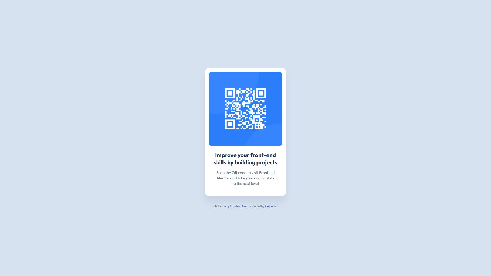

# Frontend Mentor - QR code component solution

This is a solution to the [QR code component challenge on Frontend Mentor](https://www.frontendmentor.io/challenges/qr-code-component-iux_sIO_H). Frontend Mentor challenges help you improve your coding skills by building realistic projects. 

## Table of contents

- [Frontend Mentor - QR code component solution](#frontend-mentor---qr-code-component-solution)
  - [Table of contents](#table-of-contents)
  - [Overview](#overview)
    - [Screenshot](#screenshot)
    - [Links](#links)
  - [My process](#my-process)
    - [Built with](#built-with)
    - [What I learned](#what-i-learned)
    - [Continued development](#continued-development)
  - [Author](#author)

## Overview

### Screenshot



### Links

- Solution URL: [GitHub Repository](https://github.com/ciri-dev/qr-code-component)
- Live Site URL: [Demo](https://ciri-dev.github.io/qr-code-component/)

## My process

### Built with

- Semantic HTML5 markup
- CSS custom properties
- Flexbox

### What I learned

Working on this QR code component was a great opportunity to reinforce my foundational HTML5 and CSS skills, particularly focusing on perfect alignment and clean component structures. 

One of the main takeaways was solidifying how to perfectly center a component vertically and horizontally on the screen using CSS Grid. I also used this project to practice writing cleaner stylesheets by utilizing CSS nesting, which made structuring the card's inner elements much more intuitive.

Here are a few snippets of the code I am proud of:

```html
<!-- Keeping the HTML5 structure semantic and straightforward -->
<main>
    <article class="card">
      
      <h1>Improve your front-end skills by building projects</h1>
      <p>Scan the QR code to visit Frontend Mentor and take your coding skills to the next level</p>
    </article>
  </main>
```

### Continued development

In future projects, I want to continue refining my CSS architecture, especially as I move on to larger layouts and more complex landing pages. I plan to keep utilizing native CSS nesting to write more efficient and readable code.

Additionally, I want to continue streamlining my deployment process for these front-end challenges using GitHub Pages, and I look forward to integrating build tools like Vite or Rollup into my workflow as the scale of the challenges increases.

## Author

- Frontend Mentor - [@ciri-dev](https://www.frontendmentor.io/profile/ciri-dev)
- Twitter - [@ciri_dev](https://www.x.com/ciri_dev)
